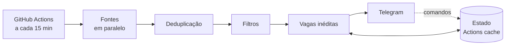

# Radar de Vagas

[](https://github.com/llorenzojorge/radar-vagas/actions/workflows/ci.yml)
[](LICENSE)


Monitor de vagas remotas de nível **júnior, estágio e trainee** em tecnologia. Agrega múltiplas fontes, aplica filtros de senioridade e área, elimina duplicatas e envia as vagas novas para o **Telegram** poucos minutos após a publicação.

Roda em GitHub Actions, sem servidor e sem banco de dados.

## Funcionalidades

- **Agregação de fontes:** Gupy, repositórios comunitários de vagas no GitHub, alertas de vaga do LinkedIn (via Gmail) e, opcionalmente, Remotive, Remote OK e We Work Remotely.
- **Filtros configuráveis:** senioridade, área, stack, idade máxima da vaga e região de contratação.
- **Vagas internacionais sob demanda:** ocultas por padrão e alternáveis pelo próprio bot (`/internacionais`).
- **Deduplicação persistente:** cada vaga é notificada uma única vez.
- **Resumo diário de recrutadores:** links para a busca de publicações das últimas 24 horas no LinkedIn.
- **Execução resiliente:** fontes rodam em paralelo, e a falha de uma não interrompe as demais.

## Arquitetura



```
src/
├── main.mjs            Ponto de entrada e orquestração (CLI)
├── sources/            Adaptadores das fontes de vagas
├── core/               Regras de negócio: modelo, filtros, deduplicação, formatação
├── bot/                Comandos do bot do Telegram
├── notifiers/          Cliente da API do Telegram
├── storage/            Persistência do estado
└── lib/                Utilitários: HTTP, texto, datas, concorrência
radar.config.mjs        Configuração
test/                   Testes (node:test)
```

Detalhes técnicos em [docs/DOCUMENTACAO.md](docs/DOCUMENTACAO.md).

## Início rápido

**Requisitos:** Node.js 22 ou superior e um bot do Telegram ([@BotFather](https://t.me/BotFather)).

```bash
git clone https://github.com/llorenzojorge/radar-vagas.git
cd radar-vagas
npm install
cp .env.example .env   # preencha TELEGRAM_TOKEN e TELEGRAM_CHAT_ID
npm run preview        # simulação: exibe o resultado sem notificar
npm start              # execução real
```

| Comando | Descrição |
|---|---|
| `npm start` | Executa o radar e envia as notificações |
| `npm run preview` | Simulação com o motivo de cada descarte |
| `npm test` | Executa a suíte de testes |
| `node src/main.mjs --help` | Lista as opções da linha de comando |

## Implantação no GitHub Actions

1. Faça um fork ou clone deste repositório para a sua conta.
2. Em **Settings → Secrets and variables → Actions**, cadastre:

   | Secret | Obrigatório | Descrição |
   |---|---|---|
   | `TELEGRAM_TOKEN` | Sim | Token do bot, gerado pelo @BotFather |
   | `TELEGRAM_CHAT_ID` | Sim | ID do chat que recebe as notificações |
   | `GMAIL_USER` | Não | Endereço do Gmail que recebe os alertas do LinkedIn |
   | `GMAIL_APP_PASSWORD` | Não | [Senha de app](https://myaccount.google.com/apppasswords) do Google |

3. Em **Actions**, habilite os workflows e execute **Radar → Run workflow** para validar.

O workflow `Radar` roda a cada 15 minutos, das 08h às 22h45 (horário de Brasília). O agendamento pode ser ajustado em [`.github/workflows/radar.yml`](.github/workflows/radar.yml).

## Comandos do bot

| Comando | Ação |
|---|---|
| `/internacionais` | Alterna a exibição de vagas internacionais |
| `/internacionais on` \| `off` | Define a exibição explicitamente |
| `/status` | Exibe a configuração atual e os comandos disponíveis |

Os comandos são processados no início de cada execução.

## Configuração

Os filtros e as fontes ficam em [`radar.config.mjs`](radar.config.mjs). Principais opções:

| Opção | Padrão | Descrição |
|---|---|---|
| `includeInternational` | `false` | Exibe vagas internacionais |
| `maxAgeDays` | `7` | Idade máxima da vaga, em dias |
| `maxJobsPerRun` | `25` | Limite de vagas por notificação |
| `levels` / `excludedLevels` | — | Senioridades aceitas e rejeitadas |
| `includeWithoutLevel` | `true` | Aceita vagas sem senioridade no título |
| `stack` | `[]` | Exige ao menos uma tecnologia (ex.: `["react", "node*"]`) |
| `sources.*.enabled` | `true` | Habilita ou desabilita cada fonte |

## Limitações

- **Publicações do LinkedIn:** não há API pública de busca, e automatizar uma sessão autenticada viola os termos de uso. Por isso o projeto envia links para a busca em vez de coletar as publicações.
- **Gupy:** a coleta depende da estrutura pública do portal e pode exigir ajuste se ela mudar.
- **Remotive:** a API pública entrega as vagas com 24 horas de atraso.
- **Agendamento:** o GitHub Actions não garante pontualidade, e execuções agendadas podem atrasar alguns minutos.

## Licença

Distribuído sob a licença [MIT](LICENSE).
