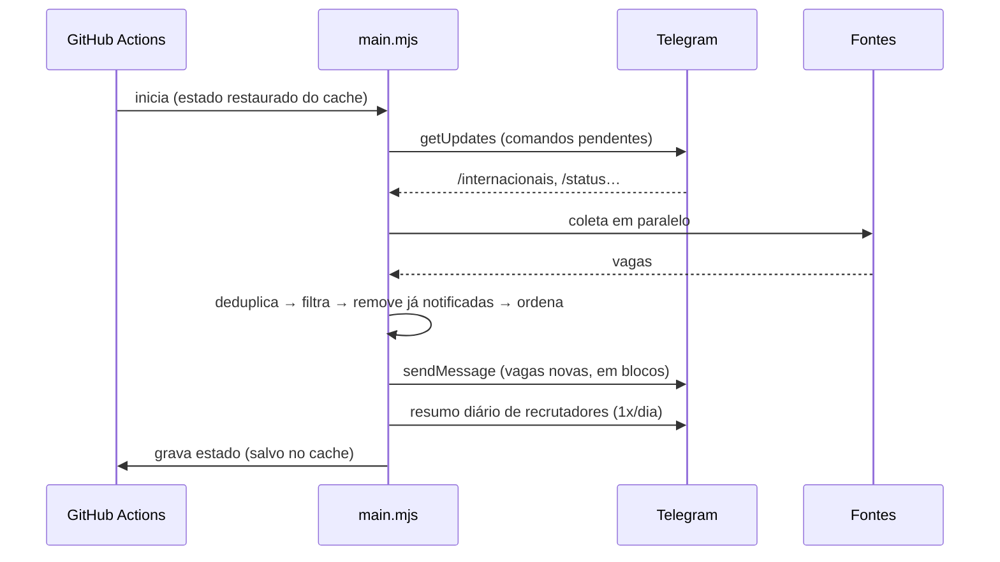

# Documentação técnica

## Sumário

1. [Visão geral](#visão-geral)
2. [Fluxo de execução](#fluxo-de-execução)
3. [Camadas](#camadas)
4. [Modelo de dados](#modelo-de-dados)
5. [Fontes](#fontes)
6. [Regras de filtragem](#regras-de-filtragem)
7. [Estado e persistência](#estado-e-persistência)
8. [Bot do Telegram](#bot-do-telegram)
9. [Infraestrutura (GitHub Actions)](#infraestrutura-github-actions)
10. [Segurança](#segurança)
11. [Adicionando uma nova fonte](#adicionando-uma-nova-fonte)
12. [Testes](#testes)

## Visão geral

O Radar de Vagas é um processo em lote, sem estado em memória entre execuções. Cada execução coleta vagas, filtra, compara com as já notificadas, envia as novas e persiste o estado. Não há servidor nem banco de dados: o agendamento e a persistência são feitos pelo GitHub Actions.

Dependências de runtime: apenas `imapflow` e `mailparser`, carregadas sob demanda somente quando a fonte de alertas do LinkedIn está configurada. O restante usa a biblioteca padrão do Node.js (`fetch`, `node:test`, `node:util`).

## Fluxo de execução



O estado só é gravado depois que as notificações são enviadas com sucesso. Se o envio falhar, as vagas voltam a ser consideradas na execução seguinte e nada se perde.

## Camadas

| Camada | Diretório | Responsabilidade | Depende de |
|---|---|---|---|
| Entrada | `src/main.mjs` | CLI, orquestração do fluxo | todas |
| Fontes | `src/sources/` | Adaptar cada site ao modelo `Job` | `core/job`, `lib` |
| Domínio | `src/core/` | Modelo, filtros, deduplicação, formatação | `lib` |
| Bot | `src/bot/` | Interpretar comandos e alterar o estado | — |
| Notificação | `src/notifiers/` | Cliente HTTP da API do Telegram | — |
| Persistência | `src/storage/` | Leitura e gravação atômica do estado | `node:fs` |
| Utilitários | `src/lib/` | HTTP com retry, normalização de texto, datas, concorrência | — |

As camadas de domínio e de bot são funções puras sobre dados, testáveis sem rede.

## Modelo de dados

Definições completas em [`src/core/types.mjs`](../src/core/types.mjs).

**Job**

| Campo | Tipo | Descrição |
|---|---|---|
| `id` | `string` | Identificador estável prefixado pela fonte (`gupy:123`, `gh:backend-br/vagas#42`) |
| `title`, `company`, `location`, `url`, `source` | `string` | Dados de exibição |
| `region` | `string` | Região de contratação exigida (somente fontes internacionais) |
| `publishedAt` | `Date \| null` | Data de publicação |
| `description` | `string` | Texto puro, usado no filtro de stack |
| `tags` | `string[]` | Etiquetas da fonte |
| `international` | `boolean` | Vaga estrangeira ou que exige inglês/pagamento em dólar |
| `levelPrefiltered` | `boolean` | A fonte já filtra senioridade (alertas do LinkedIn) |

**State**

| Campo | Descrição |
|---|---|
| `includeInternational` | Preferência definida pelo bot (`null` = usar a configuração) |
| `seen` | Mapa `id → data da notificação`, podado após 45 dias |
| `telegramOffset` | Último `update_id` confirmado na API do Telegram |
| `lastRecruiterDigest` | Data local do último resumo de recrutadores |

## Fontes

| Fonte | Método | Escopo | Observações |
|---|---|---|---|
| Gupy | HTML (`__NEXT_DATA__`) do portal público | Nacional | 12 vagas mais recentes por termo; termos executados com concorrência 4 |
| GitHub | REST API (issues abertas) | Nacional | Considera apenas issues com "remoto" no título ou nas etiquetas |
| LinkedIn | IMAP do Gmail (somente leitura) | Nacional | Lê e-mails de `jobalerts-noreply@linkedin.com`; título extraído do HTML, com o texto puro como alternativa |
| Remotive | API JSON pública | Internacional | Atraso de 24h imposto pela API |
| Remote OK | API JSON pública | Internacional | — |
| We Work Remotely | RSS por categoria | Internacional | Back-end, front-end e full-stack |

Fontes internacionais só são executadas quando a exibição de vagas internacionais está ativa.

Todas as requisições HTTP usam timeout de 30s e uma nova tentativa em erros de rede ou respostas 5xx.

## Regras de filtragem

Aplicadas em ordem por `createJobFilter` ([`src/core/filter.mjs`](../src/core/filter.mjs)). A primeira regra violada define o motivo do descarte:

1. **Internacional:** a vaga é marcada como internacional se vier de fonte estrangeira ou se o título/etiquetas contiverem um termo de `internationalMarkers`. É descartada se a exibição estiver desativada.
2. **Região:** para fontes estrangeiras, a região exigida deve constar em `acceptedInternationalLocations`.
3. **Idade:** publicada há no máximo `maxAgeDays` dias.
4. **Área:** o título deve conter um termo de `roles`.
5. **Senioridade:** o título deve conter um termo de `levels`. Sem ele, a vaga é rejeitada se contiver um termo de `excludedLevels`, e as etiquetas são usadas apenas como critério de desempate. Ignorada para fontes com `levelPrefiltered`.
6. **Stack:** se `stack` não estiver vazio, título, etiquetas ou descrição devem conter ao menos uma tecnologia.

A correspondência de termos (`createMatcher`) é feita por palavra inteira, sem acentos e sem diferenciar maiúsculas. Um `*` final indica prefixo.

`npm run preview` exibe cada descarte com o respectivo motivo.

## Estado e persistência

- **Local:** `.state/state.json` (ignorado pelo Git), configurável por `RADAR_STATE_PATH`.
- **GitHub Actions:** o diretório `.state` é restaurado e salvo com `actions/cache`. Cada execução grava uma nova entrada (`radar-state-<run_id>`) e a seguinte restaura a mais recente pelo prefixo. O estado não é versionado, o que mantém o histórico do repositório limpo e não expõe dados de uso.
- A gravação é atômica (arquivo temporário seguido de `rename`).
- O GitHub remove entradas de cache sem acesso por 7 dias. Se isso ocorrer, a próxima execução parte de um estado vazio e pode reenviar vagas dos últimos `maxAgeDays` dias.

## Bot do Telegram

O bot não mantém conexão aberta: os comandos são lidos via `getUpdates` no início de cada execução, e as atualizações lidas são confirmadas pelo `offset`. Apenas mensagens do chat definido em `TELEGRAM_CHAT_ID` são processadas; as demais são descartadas.

Precedência da exibição de vagas internacionais:

1. Flag de linha de comando (`--international` / `--no-international`) ou entrada do `workflow_dispatch`
2. Preferência definida pelo bot (`/internacionais`)
3. `includeInternational` em `radar.config.mjs`

## Infraestrutura (GitHub Actions)

| Workflow | Gatilho | Função |
|---|---|---|
| `radar.yml` | `schedule` (a cada 15 min, 08h–22h45 BRT) e `workflow_dispatch` | Executa o radar |
| `ci.yml` | `push` em `main` e `pull_request` | Testes em Node.js 22 e 24 |

Decisões:

- **Actions fixadas por SHA**, com a versão em comentário, e atualizadas pelo Dependabot.
- **Permissões mínimas:** `contents: read`. O `actions: write` existe apenas para a etapa de keepalive.
- **Keepalive:** o GitHub desativa agendamentos de repositórios públicos após 60 dias sem atividade. Reabilitar o workflow pela API a cada execução agendada evita isso sem gerar commits.
- **`concurrency`** impede execuções sobrepostas, que poderiam duplicar notificações.
- Repositórios públicos têm minutos ilimitados no GitHub Actions.

## Segurança

Ver também [SECURITY.md](../SECURITY.md).

- Nenhuma credencial é versionada. Os segredos ficam em GitHub Actions Secrets ou em `.env` local.
- Os secrets não ficam disponíveis para workflows disparados por pull requests de forks.
- Erros HTTP registram apenas a origem e o caminho da URL, nunca query strings. Erros do Telegram não incluem o token.
- Todo conteúdo externo é escapado antes de compor o HTML enviado ao Telegram.
- O IMAP abre a caixa de entrada em modo somente leitura.

## Adicionando uma nova fonte

1. Crie `src/sources/<nome>.mjs` exportando um objeto `Source`:

   ```js
   import { fetchJson } from "../lib/http.mjs";
   import { createJob, parseDate } from "../core/job.mjs";

   /** @type {import("../core/types.mjs").Source} */
   export default {
     key: "exemplo",
     international: false,
     async fetch(options, { warn }) {
       const data = await fetchJson("https://exemplo.com/api/vagas");
       return data.map((item) => createJob({
         id: `exemplo:${item.id}`,
         title: item.titulo,
         url: item.link,
         source: "Exemplo",
         publishedAt: parseDate(item.data),
       }));
     },
   };
   ```

2. Registre a fonte em `SOURCES`, no arquivo [`src/sources/index.mjs`](../src/sources/index.mjs).
3. Adicione `exemplo: { enabled: true }` em `sources`, no `radar.config.mjs`.
4. Valide com `npm run preview`.

Uma fonte pode retornar `{ skipped: "motivo" }` quando não estiver configurada (por exemplo, sem credenciais).

## Testes

```bash
npm test
```

A suíte (`node:test`) cobre normalização de texto, filtros, deduplicação, formatação, comandos do bot, resumo diário, parser de e-mails do LinkedIn, persistência do estado e controle de concorrência. Os testes não acessam a rede.
